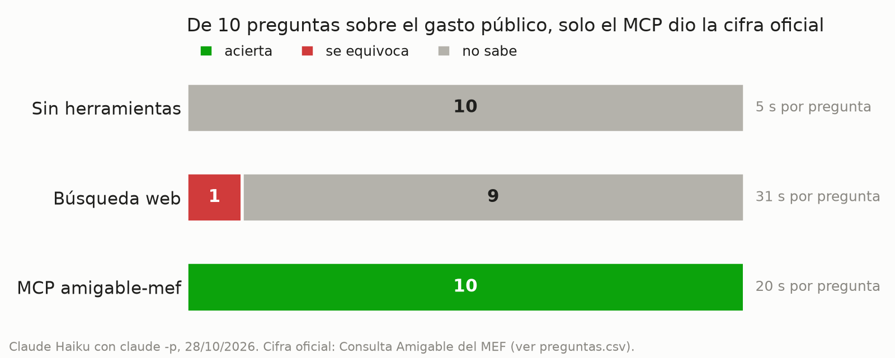

# Informe · ¿Le sirve a Claude un MCP de la Consulta Amigable?

Hice las mismas 10 preguntas sobre el presupuesto público del Perú a Claude Haiku (`claude -p`) en tres modos:
sin herramientas, con búsqueda web y con el MCP `amigable-mef`. Cada respuesta se comparó con la cifra oficial de
la [Consulta Amigable del MEF](https://apps5.mineco.gob.pe/transparencia/Navegador/default.aspx?y=2025&ap=ActProy).
Corrida del 28 de octubre de 2026; los datos están en `resultados.csv` y las preguntas en `preguntas.csv`.

## Resultados

| Modo | Aciertos | Errores | «No sé» | Segundos promedio | Turnos promedio |
|---|---:|---:|---:|---:|---:|
| Sin herramientas (`memoria`) | 0 | 0 | 10 | 5.3 | 2.0 |
| Búsqueda web (`web`) | 0 | 1 | 9 | 30.6 | 6.1 |
| MCP `amigable-mef` (`mcp`) | **10** | 0 | 0 | 20.5 | 5.2 |

La corrida base, solo memoria contra MCP (`resultados_base.csv`), dio lo mismo: 10 «no sé» contra 10 aciertos.

## Qué falló cada modo y por qué

**Sin herramientas.** Dijo «no sé» en las 10 preguntas y no inventó ninguna cifra. La instrucción de
`evaluar.py` le permite responder `null` si no está seguro, y Haiku la usó siempre: explicaba que no tenía acceso a
la Consulta Amigable y dónde buscarla. Son cifras de 2024 y 2025, posteriores o muy cercanas a lo que el modelo
pudo aprender, y además demasiado específicas (un grupo funcional de una municipalidad) para recordarlas.

**Búsqueda web.** No acertó ninguna. La columna `fuente` muestra tres motivos:

- **No llega a la fuente.** La Consulta Amigable no tiene una URL por consulta: cada tabla sale de clics que
  reenvían un formulario. Haiku probó dominios que no existen (`consultaamigable.mef.gob.pe`) y no pudo navegarla.
- **Encuentra informes con cifras de otro momento.** El único número que dio, el PIM total de 2025, fue
  S/ 272,405.4 millones sacado del *Pulso MEF* de diciembre de 2025. El dato vigente es 272,450.86: el informe es
  una foto anterior al cierre del año, 45 millones más baja.
- **Encuentra cifras parecidas pero no iguales.** Para el canon de 2024 halló S/ 20,648.8 millones en un reporte
  del Congreso, pero no pudo confirmar que fuera el mismo concepto (el PIM del rubro 18) y respondió «no sé».

Fue además el modo más lento: 30.6 s y 6.1 turnos por pregunta, buscando sin llegar a nada.

**MCP.** Acertó las 10, incluidas las que exigen varios niveles de filtros: seguridad vecinal y comunal de la
Municipalidad de Lima (cinco pasos de navegación), transporte terrestre en Cajamarca en 2020 y la variación del
programa 0017 entre 2021 y 2025, que calculó la herramienta `barrido` y no el modelo. En cada respuesta citó la ruta
de filtros y el link. Una advertencia: casi todas las rutas ya estaban en la caché (`datos/cache/`) por las pruebas
del mismo día, así que los 20.5 s son sobre todo razonamiento del modelo. Sin caché, cada paso de navegación suma
entre 4 y 8 segundos.

## Cifras del MCP comprobadas a mano

Consulta Amigable no da un link por tabla, así que anoto el link de inicio del año y los clics.

| Pregunta | MCP | Web del MEF | Dónde |
|---|---:|---:|---|
| Devengado 2025 en el departamento de Cusco, tres niveles de gobierno | 11,548,296,156.50 | 11,548,296,157 | [Consulta Amigable 2025](https://apps5.mineco.gob.pe/transparencia/Navegador/default.aspx?y=2025&ap=ActProy) → ¿Dónde se gasta? Departamento → 08: CUSCO, columna Devengado |
| Devengado 2025 del sector Salud del Gobierno Nacional | 14,145,619,007.79 | 14,145,619,008 | [Consulta Amigable 2025](https://apps5.mineco.gob.pe/transparencia/Navegador/default.aspx?y=2025&ap=ActProy) → Nivel de Gobierno → E → Sector → 11: SALUD, columna Devengado |

La web redondea al sol; el MCP lee los decimales que trae cada fila. Las otras dos preguntas propias,
el canon de 2024 (S/ 23,772,698,438) y el avance de los gobiernos regionales en 2024 (94.9 %), también las comprobé
en la web. El resto de cifras correctas y cómo se verificó cada una está en la columna `verificado` de
`preguntas.csv`.

## Conclusión

Un MCP vale la pena cuando los datos viven detrás de una interfaz, no en páginas publicadas: la Consulta Amigable
tiene millones de combinaciones de filtros y ninguna tiene URL, así que la búsqueda web no llega y termina citando
informes desactualizados. Con el BCRP pasa lo contrario: sus cifras salen en notas y reportes, y en la referencia
del curso la web acertaba 7 de 8. La búsqueda web basta para cifras famosas y publicadas; para una cifra de un pliego, una municipalidad o un
grupo funcional, el MCP no solo acierta, también deja la ruta para repetir la consulta. Y el valor no es solo la
cifra: el glosario de clasificadores explica qué significa cada partida, que es justo donde se pierde quien no
conoce los filtros.
